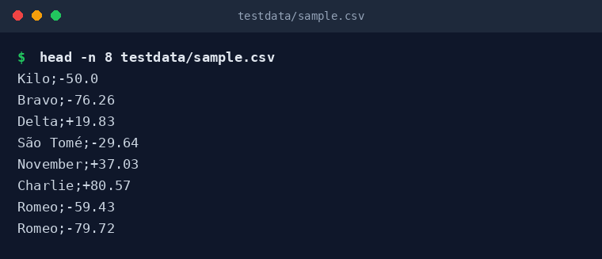
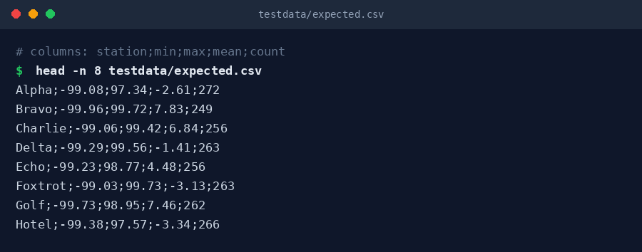
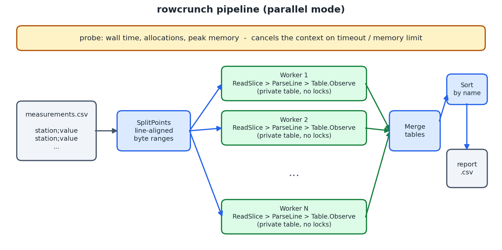
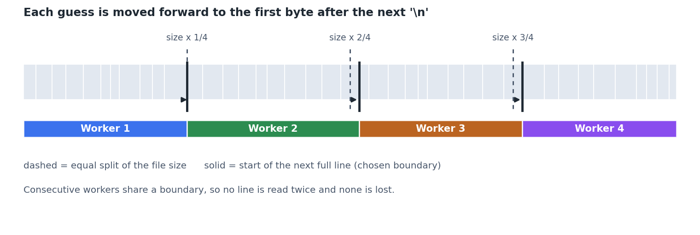
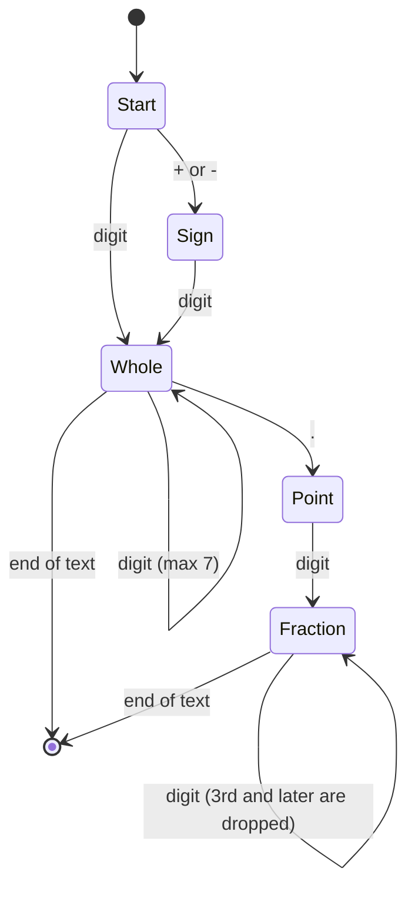
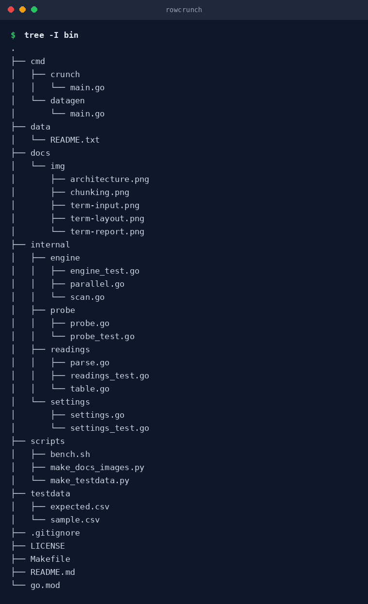

# rowcrunch

Aggregate a CSV of **one billion `station;value` rows** into per-station
min / max / mean / count, using a bounded amount of time and memory.

- Pure Go standard library, no third-party dependencies
- Two interchangeable strategies: a sequential baseline and a chunked parallel engine
- Fixed-point parsing (hundredths) instead of float parsing on the hot path
- Built-in time and memory budgets that cancel the run when exceeded
- Tests compare both engines against a report produced by an independent Python reference

## Quick start

```bash
make build                      # builds bin/crunch and bin/datagen
make test                       # unit + golden-file tests

make data ROWS=100000000        # generate a 100M-row file (use 1000000000 for the full run)
./bin/crunch -input data/measurements.csv            # parallel, one worker per CPU
./bin/crunch -input data/measurements.csv -mode sequential
```

Requires Go 1.22 or newer.

## Input and output

Every input line holds a station name and a temperature separated by `;`



The report has one line per station, sorted by name, with the columns
`station;min;max;mean;count`.



Format rules:

| Topic | Behaviour |
|-------|-----------|
| Number syntax | optional `+`/`-`, up to 7 integer digits, optional fractional part (`7`, `7.5`, `-0.07`, `+3.10`) |
| Precision | stored as hundredths; digits after the second decimal are truncated |
| Line endings | `\n`, with a trailing `\r` tolerated |
| Bad lines | empty separator, missing/invalid number or a line longer than 1 MiB is skipped and counted |
| Mean | `sum / count / 100`, printed with two decimals |
| Station names | any bytes except a newline; the value is whatever follows the **last** `;` |

## How it works



### 1. Cut the file into line-aligned ranges

The file size is divided into `workers` equal parts. Each cut point is then moved
forward to the first byte after the next newline, so every range starts on a line
boundary and neighbouring ranges share exactly one boundary.



### 2. Scan each range independently

Every worker reads its range through an `io.SectionReader` and a 1 MiB
`bufio.Reader`. `ReadSlice` hands out lines without copying, `ParseLine` turns
one into `(station []byte, value int32)`, and `Table.Observe` updates a private map.
The lookup `m[string(b)]` does not allocate; a string is created only the first time
a station appears. Because tables are private there are no locks in the hot loop.

### 3. Merge and report

The per-worker tables are merged once, station names are sorted and the report is
written through a buffered writer.

### Number parsing

Values are parsed straight from bytes into integers. The accepted grammar is small
enough to be a small state machine:



### Design decisions

| Decision | Reason |
|----------|--------|
| Fixed-point `int32` hundredths | exact sums, no `strconv.ParseFloat`, no float rounding drift in the running mean |
| Mean computed once from `Sum` and `Count` | the previous running-average update accumulates rounding error and costs a division per row |
| One table per worker | no synchronisation while scanning; merge cost depends on the number of stations, not rows |
| `ReadSlice` + `LastIndexByte` | no per-line allocation; the number is short, so searching from the end is cheap |
| Context-based limits | a timeout or memory breach cancels every worker instead of killing the process mid-write |

## Configuration

Each option is a flag; its default comes from an environment variable, which falls
back to a built-in value. Flags win over the environment.

| Flag | Environment variable | Default | Meaning |
|------|----------------------|---------|---------|
| `-input` | `CRUNCH_INPUT` | `data/measurements.csv` | file to read |
| `-output` | `CRUNCH_OUTPUT` | `data/report.csv` | where the report is written |
| `-metrics` | `CRUNCH_METRICS` | `data/runs.log` | one line appended per run (empty disables) |
| `-mode` | `CRUNCH_MODE` | `parallel` | `sequential` or `parallel` |
| `-workers` | `CRUNCH_WORKERS` | number of CPUs | readers in parallel mode |
| `-timeout` | `CRUNCH_TIMEOUT` | `10m` | abort a run that takes longer (`0` disables) |
| `-mem-limit` | `CRUNCH_MEM_LIMIT_MB` | `24576` | abort above this many MiB obtained from the OS (`0` disables) |

## Project layout



| Package | Responsibility |
|---------|----------------|
| `internal/readings` | line parsing, per-station aggregate, table, report writer |
| `internal/engine` | shared scanner, `Sequential`, `Parallel`, `SplitPoints` |
| `internal/probe` | time/allocation/peak-memory measurement and budget enforcement |
| `internal/settings` | flags and environment handling |
| `cmd/crunch` | command-line entry point |
| `cmd/datagen` | reproducible synthetic data generator |
